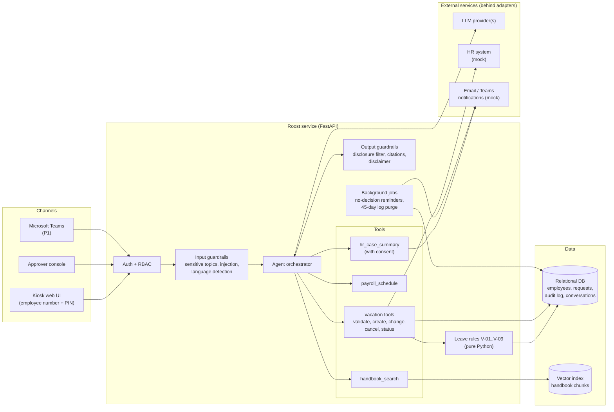
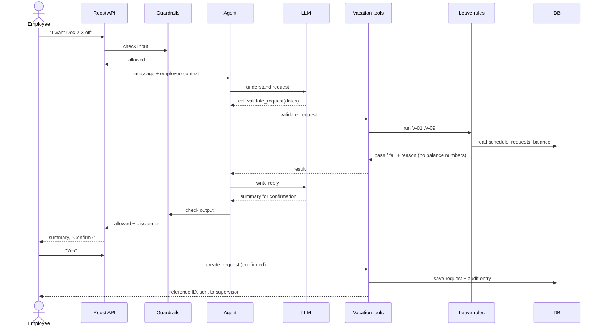

# Roost HR Assistant: System Architecture

| Field | Value |
|---|---|
| Status | Draft v0.1 (decisions recorded in [ADRs](adr/)) |
| Last updated | 2026-10-31 |
| Requirements | [01-requirements.md](01-requirements.md) |

## 1. Architecture at a glance

Roost is a **modular monolith**: one deployable Python service, organized into
modules with clear responsibilities. Every request passes through authentication
and input guardrails before the agent sees it, and through output guardrails
before the employee sees the answer. Business rules live in deterministic code,
never in the LLM.

## 2. Components

| Component | Responsibility | Module | Requirements |
|---|---|---|---|
| Channels | Kiosk UI, approver console, Teams adapter (P1) | frontend (later), `adapters/` | FR-03, FR-21, FR-40 |
| Auth + RBAC | PIN sign-in, lockout, sessions, roles | `auth/` | FR-40–FR-43 |
| Input guardrails | Detect sensitive topics and prompt injection before the LLM; detect language | `guardrails/` | FR-03, FR-30, NFR-04 |
| Agent orchestrator | Runs the conversation, decides which tool to call, keeps conversation state | `agent/` | FR-01, FR-10 |
| Tools | The only way the agent can read data or act; every tool checks permissions server-side | `tools/` | FR-05, FR-10–FR-14, FR-32 |
| Leave rules | Deterministic validation of V-01..V-09 | `leave/` | V-01–V-09 |
| Retrieval (RAG) | Ingest, chunk, embed and search the handbook; return text with section citations | `rag/` | FR-01, FR-02, FR-44 |
| Output guardrails | Block restricted data, verify citations, add disclaimer | `guardrails/` | FR-04, FR-06 |
| LLM client | Provider-agnostic calls with fallback | `llm/` | NFR-09, NFR-10 |
| Background jobs | No-decision reminders, log retention purge | `core/` (scheduler) | FR-23, FR-45 |
| Persistence | Employees (mock HRIS), requests, audit log, conversations | `db/` | FR-24, FR-45 |
| Observability | Structured logs, traces, token and cost tracking | `observability/` | NFR-11 |

## 3. Key flow: submitting a vacation request

Two properties to notice:

1. The LLM only *proposes* tool calls. The tool runs the rules, and the rules
   return pass/fail with a reason, never a balance number.
2. Creating the request requires the employee's explicit confirmation, which is
   handled by the service, not left to the LLM.

## 4. Architecture decisions

Each significant decision is recorded as an Architecture Decision Record (ADR)
in [`docs/adr/`](adr/).

| ADR | Decision | Status |
|---|---|---|
| 0001 | Record architecture decisions | Accepted |
| 0002 | Modular monolith in Python | Accepted |
| 0003 | Agent framework | Pending |
| 0004 | LLM provider strategy | Pending |
| 0005 | Embeddings and vector store | Pending |
| 0006 | Multilingual approach | Pending |
| 0007 | Relational database | Pending |
| 0008 | Channel adapters (kiosk, approver console, Teams) | Pending |
