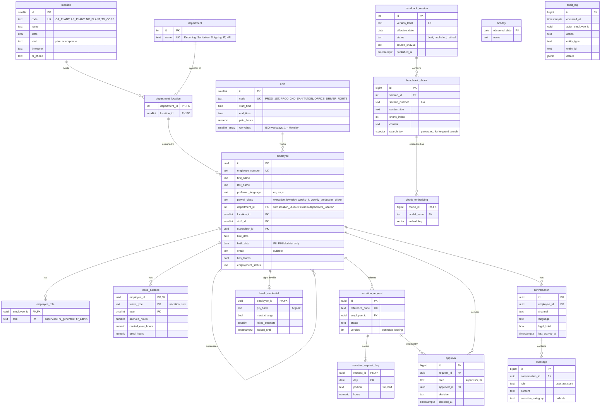

# Roost HR Assistant: Data Model

| Field | Value |
|---|---|
| Status | Draft v0.1 |
| Last updated | 2026-10-31 |
| Decisions | [ADR-0005](adr/0005-embeddings-and-vector-store.md), [ADR-0007](adr/0007-relational-database.md) |

All tables live in one PostgreSQL database. Tables are built in the phase that
first needs them; this document shows the full target model so each migration
fits the whole.

## 1. Overview

`holiday` and `audit_log` have no foreign keys: holidays apply to everyone, and
the audit log must survive even if the rows it describes change.

## 2. Tables by phase

| Phase | Tables | Purpose |
|---|---|---|
| 3 (data pipeline) | `location`, `department`, `department_location`, `shift`, `employee`, `employee_role`, `leave_balance`, `holiday` | Mock HR system with synthetic data |
| 3 (data pipeline) | `handbook_version`, `handbook_chunk`, `chunk_embedding` | Handbook storage and search |
| 5 (core logic) | `vacation_request`, `vacation_request_day` | Vacation requests (create, change, cancel, status) |
| 5 (core logic) | LangGraph checkpoint tables, in the `agent_memory` schema | Conversation state and paused confirmations |
| 8 (API) | `approval`, `audit_log`, `kiosk_credential` | Supervisor and HR approvals, audit trail, kiosk sign-in |
| 9 (observability) | `conversation`, `message` | Transcripts for the 45-day record policy and legal holds |

LangGraph's checkpoint tables are created and managed by its own library, not by our
migrations. An Alembic migration creates the `agent_memory` schema they live in, so
autogenerate and `alembic check` never see them (ADR-0010).

## 3. Design decisions

| Decision | Reason |
|---|---|
| UUID primary keys for `employee`, `vacation_request`, `conversation` | These IDs appear in URLs and API calls; random UUIDs cannot be guessed or counted. Internal tables use integers. |
| Departments are company-wide; `department_location` lists where each one operates | A department (e.g. Deboning, Sanitation) exists at several plants. The employee's (department, location) pair is a composite foreign key to `department_location`, so nobody can be assigned to a department that does not operate at their location. |
| Department limit counted per department, location and shift | The 15% limit (Section 6.6) applies to the people who actually work together: one department at one plant on one shift. |
| `employee_number` separate from `id` | The employee number is a business identifier people know (it is on badges); the UUID is the internal key. |
| `leave_balance` per employee, type and year | Matches how accrual, carryover (Section 6.9) and the yearly sick grant (Section 8.1) work. Available hours = accrued + carried over − used − pending requests. |
| `vacation_request_day` rows | Each day can be a full or half day (Section 6.3) and is checked against holidays (Section 12.5) and department limits (Section 6.6) individually. |
| `version` column on `vacation_request` | Optimistic locking: two approvers acting at the same moment cannot overwrite each other's decision. |
| `chunk_embedding` separate from `handbook_chunk`, keyed by model name | Several embedding models can be stored side by side, so Phase 4 can compare candidates on the same chunks, and switching models never requires downtime. Each model gets its own vector index. |
| Generated `search_tsv` column | Postgres keeps the keyword-search index in sync with `content` automatically (ADR-0005 hybrid search). |
| Only one handbook version `published` at a time | Enforced with a partial unique index; publishing is one transaction (FR-44). |
| `audit_log` insert-only | Enforced by database permissions and a trigger (ADR-0007, FR-24). |
| `birth_date` marked as PII | Used only to block birth-date PINs (FR-40); never sent to the LLM or shown in the UI (NFR-05). |
| `message.sensitive_category` | Lets analytics count sensitive topics by category without reading content (FR-49). |
| Times stored as `timestamptz` | Plants span Eastern and Central time zones; all timestamps are stored in UTC and converted for display using the location's time zone. |
