# Roost HR Assistant: Data Model

| Field | Value |
|---|---|
| Status | v0.3: Phase 9 tables built |
| Last updated | 2026-11-07 |
| Decisions | [ADR-0005](adr/0005-embeddings-and-vector-store.md), [ADR-0007](adr/0007-relational-database.md), [ADR-0013](adr/0013-api-layer.md), [ADR-0014](adr/0014-observability.md) |

All tables live in one PostgreSQL database. Tables are built in the phase that
first needs them; this document shows the full target model so each migration
fits the whole.

## 1. Overview

```mermaid
erDiagram
    location ||--o{ department_location : hosts
    department ||--o{ department_location : "operates at"
    department_location ||--o{ employee : "assigned to"
    shift ||--o{ employee : works
    employee ||--o{ employee : supervises
    employee ||--o{ employee_role : has
    employee ||--o{ leave_balance : has

    handbook_version ||--o{ handbook_chunk : contains
    handbook_chunk ||--o{ chunk_embedding : "embedded as"

    employee ||--o{ vacation_request : submits
    vacation_request ||--|{ vacation_request_day : covers
    vacation_request ||--o{ approval : "decided in rounds"
    employee ||--o{ approval : "assigned or decides"
    location ||--o{ approval : "HR step for"
    employee ||--o| kiosk_credential : "signs in with"
    employee ||--o| console_credential : "approves with"
    employee ||--o{ web_session : "signed in as"
    employee ||--o{ notification : receives
    vacation_request ||--o{ notification : about
    employee ||--o{ hr_referral : "asked HR"
    location ||--o{ hr_referral : "read by HR at"
    employee ||--o{ conversation : has
    conversation ||--o{ message : contains

    location {
        smallint id PK
        text code UK "GA_PLANT, AR_PLANT, NC_PLANT, TX_CORP"
        text name
        char state
        text kind "plant or corporate"
        text timezone
        text hr_phone
    }
    department {
        int id PK
        text name UK "Deboning, Sanitation, Shipping, IT, HR ..."
    }
    department_location {
        int department_id PK, FK
        smallint location_id PK, FK
    }
    shift {
        smallint id PK
        text code UK "PROD_1ST, PROD_2ND, SANITATION, OFFICE, DRIVER_ROUTE"
        time start_time
        time end_time
        numeric paid_hours
        smallint_array workdays "ISO weekdays, 1 = Monday"
    }
    employee {
        uuid id PK
        text employee_number UK
        text first_name
        text last_name
        text preferred_language "en, es, vi"
        text payroll_class "executive, biweekly, weekly_it, weekly_production, driver"
        int department_id FK "with location_id, must exist in department_location"
        smallint location_id FK
        smallint shift_id FK
        uuid supervisor_id FK
        date hire_date
        date birth_date "PII: PIN blocklist only"
        text email "nullable"
        bool has_teams
        text employment_status
    }
    employee_role {
        uuid employee_id PK, FK
        text role PK "supervisor, hr_generalist, hr_admin"
    }
    leave_balance {
        uuid employee_id PK, FK
        text leave_type PK "vacation, sick"
        smallint year PK
        numeric accrued_hours
        numeric carried_over_hours
        numeric used_hours
    }
    holiday {
        date observed_date PK
        text name
    }
    handbook_version {
        int id PK
        text version_label "1.0"
        date effective_date
        text status "draft, published, retired"
        text source_sha256
        timestamptz published_at
    }
    handbook_chunk {
        bigint id PK
        int version_id FK
        text section_number "6.4"
        text section_title
        int chunk_index
        text content
        tsvector search_tsv "generated, for keyword search"
    }
    chunk_embedding {
        bigint chunk_id PK, FK
        text model_name PK
        vector embedding
    }
    vacation_request {
        uuid id PK
        text reference_code UK
        uuid employee_id FK
        text status
        int version "optimistic locking"
    }
    vacation_request_day {
        uuid request_id PK, FK
        date day PK
        text portion "full, half"
        numeric hours
    }
    approval {
        bigint id PK
        uuid request_id FK "unique with round and step"
        smallint round "1, then +1 for each change"
        text step "supervisor, hr"
        uuid assignee_id FK "supervisor step only"
        smallint hr_location_id FK "HR step only"
        text decision "pending, approved, denied"
        uuid decided_by_id FK
        text comment "nullable, shown to the employee"
        timestamptz decided_at
    }
    kiosk_credential {
        uuid employee_id PK, FK
        text pin_hash "Argon2id"
        bool must_change
        smallint failed_attempts
        timestamptz locked_until
    }
    console_credential {
        uuid employee_id PK, FK
        text password_hash "Argon2id"
        bool must_change
        smallint failed_attempts
        timestamptz locked_until
    }
    web_session {
        text token_hash PK "SHA-256 of the cookie token"
        text app "kiosk, console"
        uuid employee_id FK
        text kiosk_id "kiosk header, or the console's address"
        text language
        uuid thread_id "agent conversation"
        text csrf_token
        bool must_change_pin "PIN or password"
        text pending_text "kiosk streaming: until the stream takes it"
        timestamptz last_seen_at "idle limit"
    }
    notification {
        bigint id PK
        uuid recipient_id FK
        text channel "teams, email, kiosk"
        text kind
        uuid request_id FK "nullable"
        jsonb details "reference, days, comment; never text"
        timestamptz sent_at "null until delivered"
    }
    hr_referral {
        uuid id PK
        uuid employee_id FK
        smallint location_id FK
        text category "sensitive topic"
        text language
        text text "the employee's own words; erased 90 days after handled"
        timestamptz handled_at
        uuid handled_by_id FK
        timestamptz text_deleted_at
    }
    conversation {
        uuid id PK
        uuid thread_id "agent memory thread, unique"
        uuid employee_id FK
        text channel
        text language
        timestamptz started_at
        timestamptz last_activity_at "45-day clock"
        bool legal_hold
        uuid held_by_id FK "HR admin"
        timestamptz held_at
        text hold_reason "e.g. a case number"
    }
    message {
        bigint id PK
        uuid conversation_id FK "cascade"
        text role "employee, roost"
        text kind "message, answer, routed, question, fallback, error"
        text content "exactly as shown"
        text category "routed turns only"
        text_array cited_sections
        smallint rating "1, -1 or null (FR-47)"
    }
    turn_metric {
        bigint id PK
        timestamptz occurred_at "30 days"
        text channel
        text language
        text reply_kind
        text route
        text category
        text guardrail_source "keyword, llm, similarity"
        text_array tools
        smallint tool_errors
        bool unanswered "searched, cited nothing"
        text model
        bool fallback_used
        int input_tokens
        int output_tokens
        numeric cost_usd "at list price"
        int latency_ms
        int first_token_ms
    }
    audit_log {
        bigint id PK
        timestamptz occurred_at
        uuid actor_employee_id
        text action
        text entity_type
        text entity_id
        jsonb details
    }
```

`holiday` and `audit_log` have no foreign keys: holidays apply to everyone, and
the audit log must survive even if the rows it describes change.

## 2. Tables by phase

| Phase | Tables | Purpose |
|---|---|---|
| 3 (data pipeline) | `location`, `department`, `department_location`, `shift`, `employee`, `employee_role`, `leave_balance`, `holiday` | Mock HR system with synthetic data |
| 3 (data pipeline) | `handbook_version`, `handbook_chunk`, `chunk_embedding` | Handbook storage and search |
| 5 (core logic) | `vacation_request`, `vacation_request_day` | Vacation requests (create, change, cancel, status) |
| 5 (core logic) | LangGraph checkpoint tables, in the `agent_memory` schema | Conversation state and paused confirmations |
| 8 (API) | `approval`, `audit_log`, `kiosk_credential` | Supervisor and HR approvals, audit trail, kiosk sign-in |
| 8 (API) | `web_session`, `console_credential` | Server-side sessions for the kiosk and the approver console; console passwords |
| 8 (API) | `notification`, `hr_referral` | Notification outbox (Teams, email, kiosk); the consented note to HR (FR-32) |
| 9 (observability) | `conversation`, `message` | Transcripts for the 45-day record policy, legal holds and ratings |
| 9 (observability) | `turn_metric` | Per-turn numbers: tokens, cost, latency, guardrail category; never text (30 days) |

LangGraph's checkpoint tables are created and managed by its own library, not by our
migrations. An Alembic migration creates the `agent_memory` schema they live in, so
autogenerate and `alembic check` never see them (ADR-0010).

## 3. Design decisions

| Decision | Reason |
|---|---|
| UUID primary keys for `employee`, `vacation_request`, `conversation` | These IDs appear in URLs and API calls; random UUIDs cannot be guessed or counted. Internal tables use integers. |
| Departments are company-wide; `department_location` lists where each one operates | A department (e.g. Deboning, Sanitation) exists at several plants. The employee's (department, location) pair is a composite foreign key to `department_location`, so nobody can be assigned to a department that does not operate at their location. |
| Department limit counted per department, location and shift | The 15% limit (Section 6.6) applies to the people who actually work together: one department at one plant on one shift. |
| `employee_number` separate from `id` | The employee number is a business identifier people know (it is on badges); the UUID is the internal key. |
| `leave_balance` per employee, type and year | Matches how accrual, carryover (Section 6.9) and the yearly sick grant (Section 8.1) work. Available hours = accrued + carried over − used − pending requests. |
| `vacation_request_day` rows | Each day can be a full or half day (Section 6.3) and is checked against holidays (Section 12.5) and department limits (Section 6.6) individually. |
| `version` column on `vacation_request` | Optimistic locking: two approvers acting at the same moment cannot overwrite each other's decision. |
| `approval` rows in rounds; a decided row never changes | A change starts round N+1 (FR-13); older rounds stay as history, and a decision on an old round is refused. The supervisor step names its assignee; the HR step names a location, so any HR generalist there (or an HR admin) can decide it. Check constraints keep exactly one of the two, and decision fields set together. |
| Approved hours posted to `used_hours` | The HR system would record them. Posted on the same balance row the vacation check reads (the latest year up to the day's year), and given back when an approved request is changed or cancelled. |
| `web_session` keeps only a hash of the token | A copy of the table cannot be used to sign in. Idle limits (2 minutes kiosk, 15 console) are checked against `last_seen_at` on every request. |
| `notification` is an outbox | Written in the same transaction as the decision; delivered separately. `details` never holds a balance or anything an employee said. |
| `hr_referral` text is erased, the row kept | The words are needed only until HR follows up; the record that a referral was sent and handled stays (with the audit log entry). |
| `chunk_embedding` separate from `handbook_chunk`, keyed by model name | Several embedding models can be stored side by side, so Phase 4 can compare candidates on the same chunks, and switching models never requires downtime. Each model gets its own vector index. |
| Generated `search_tsv` column | Postgres keeps the keyword-search index in sync with `content` automatically (ADR-0005 hybrid search). |
| Only one handbook version `published` at a time | Enforced with a partial unique index; publishing is one transaction (FR-44). |
| `audit_log` insert-only | Triggers reject `UPDATE`, `DELETE` and `TRUNCATE` (ADR-0007, FR-24). The writer refuses detail keys such as `text` or `message`, so no conversation content is ever recorded. |
| `birth_date` marked as PII | Used only to block birth-date PINs (FR-40); never sent to the LLM or shown in the UI (NFR-05). |
| `message.category` | Lets analytics count sensitive topics by category without reading content (FR-49). |
| `message` is what the employee saw, not the model's history | The kiosk draws its screen from it, so the record and the screen cannot differ; the agent's working memory (LangGraph checkpoints) is deleted with the conversation. |
| `turn_metric` has no employee column and no text | Quality numbers for HR and engineering must not become a record of who asked what (FR-49, NFR-05). |
| Times stored as `timestamptz` | Plants span Eastern and Central time zones; all timestamps are stored in UTC and converted for display using the location's time zone. |
